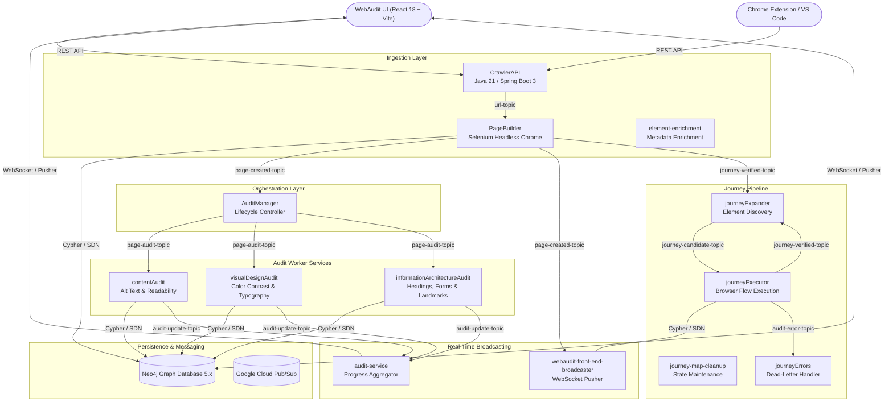
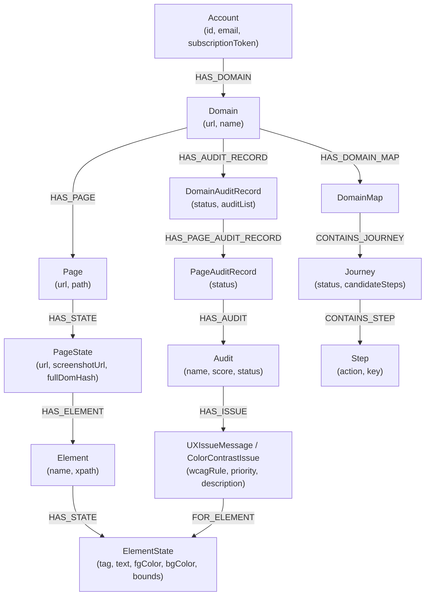

# WebAudit — Automated Website Auditing Platform

<p align="center">
  <strong>WebAudit is an automated website auditing platform that crawls and analyzes web applications to identify accessibility, content, visual-design, information-architecture, and user-journey issues.</strong>
</p>

<p align="center">
  
  
  
  
  
  
  
</p>

---

## Table of Contents

1. [What is WebAudit?](#what-is-webaudit)
2. [The Problem It Solves](#the-problem-it-solves)
3. [How WebAudit Works](#how-webaudit-works)
4. [Architecture Overview](#architecture-overview)
5. [Technology Stack](#technology-stack)
6. [Crawling Process (Selenium WebDriver)](#crawling-process-selenium-webdriver)
7. [Website Representation in Neo4j](#website-representation-in-neo4j)
8. [Audit Pipeline & Google Cloud Pub/Sub](#audit-pipeline--google-cloud-pubsub)
9. [Accessibility Auditing](#accessibility-auditing)
10. [Content Auditing](#content-auditing)
11. [Visual-Design Auditing](#visual-design-auditing)
12. [Information-Architecture Auditing](#information-architecture-auditing)
13. [User-Journey Analysis](#user-journey-analysis)
14. [Neo4j Graph Database Details](#neo4j-graph-database-details)
15. [Google Cloud Pub/Sub Messaging](#google-cloud-pubsub-messaging)
16. [Selenium Browser Automation Details](#selenium-browser-automation-details)
17. [REST APIs Reference](#rest-apis-reference)
18. [Project Structure](#project-structure)
19. [Setup Instructions](#setup-instructions)
20. [Configuration & Environment Variables](#configuration--environment-variables)
21. [How to Run the Project](#how-to-run-the-project)
22. [How to Test the Project](#how-to-test-the-project)
23. [Known Limitations](#known-limitations)
24. [Future Improvements](#future-improvements)

---

## 1. What is WebAudit?

**WebAudit** is a web-based automated website auditing platform that crawls websites, extracts rich visual and semantic page data in real browsers, and executes modular audit rules to evaluate web applications.

Unlike traditional static linters that inspect raw HTML strings without executing JavaScript, WebAudit drives a full headless browser (Selenium WebDriver with Chrome) to evaluate computed styles, render tree layouts, interactive page states, and end-to-end user journeys between pages. All extracted pages, DOM elements, audit observations, and journey transitions are stored in a **Neo4j graph database** and orchestrated asynchronously via **Google Cloud Pub/Sub**.

---

## 2. The Problem It Solves

Modern web applications present challenges that traditional static accessibility checkers miss:

- **CSS & Computed Styles Miscalculations**: A static rule checker cannot detect if text rendered over an image or CSS background has insufficient contrast, or if a sticky navigation bar obscures interactive elements. WebAudit measures contrast and spacing from actual computed styles and rendered coordinates.
- **Single-Page Applications & Dynamic DOM**: Web apps load states via JavaScript and user interaction. WebAudit discovers interactive controls, clicks through them, and audits intermediate application states (forms, modals, multi-step flows).
- **Siloed Page-by-Page Reports**: Standard scanners generate disjointed spreadsheets per URL. WebAudit stores the website as an interconnected graph, mapping how pages, elements, journeys, and issues correlate across the site.
- **Fragmented Developer Experience**: Audits often occur post-deployment via manual spreadsheets. WebAudit integrates via a React 18 TypeScript web dashboard, a Chrome browser extension, a VS Code IDE extension, and REST APIs.

---

## 3. How WebAudit Works

The end-to-end auditing lifecycle follows a systematic pipeline:

```
User / REST API / Extension
           │
           ▼
[ CrawlerAPI ] ──► Creates Domain & DomainAuditRecord in Neo4j
           │
           ▼ (Pub/Sub: url-topic)
[ PageBuilder ] ──► Drives headless Chrome via Selenium WebDriver
           │        Loads URL, computes styles, takes screenshots
           │        Persists PageState & ElementState graph in Neo4j
           │
           ├────────────────────────────┐
           ▼ (page-created-topic)       ▼ (journey-verified-topic)
   [ AuditManager ]              [ journeyExpander ]
           │                            │ Discovers clickables
           ▼ (page-audit-topic)         ▼ (journey-candidate-topic)
┌───────────────────────────────┐ [ journeyExecutor ]
│ Parallel Audit Workers:       │       │ Executes journey steps in browser
│  • contentAudit               │       ▼ Validates flow & focus
│  • visualDesignAudit          │ Re-enters loop if verified
│  • informationArchitectureAudit
└──────────────┬────────────────┘
               ▼ (audit-update-topic)
[ audit-service ] & [ front-end-broadcaster ]
               │
               ▼ (Pusher WebSocket & Neo4j writes)
[ WebAudit React UI / Clients ]
```

1. **Initiation**: A user submits a domain or URL through the WebAudit web dashboard, browser extension, or `POST /v1/domains`.
2. **Ingestion & Browser Extraction**: `PageBuilder` receives the message, launches headless Chrome, extracts the complete DOM tree, calculates computed CSS styles, captures full-page and element screenshots, and writes the structured graph into Neo4j.
3. **Audit Dispatch**: `AuditManager` captures the built page event and dispatches audit jobs to specialized microservices over Pub/Sub.
4. **Multi-Disciplinary Evaluation**: Dedicated workers evaluate the page concurrently:
   - **Visual Design**: Contrast (WCAG AA/AAA), font sizes, typography, whitespace, element spacing.
   - **Content**: Alt-text coverage across media types, reading grade levels, paragraph structure.
   - **Information Architecture**: Heading hierarchies, semantic landmarks, form controls, table structures, descriptive links.
5. **Journey Exploration**: `journeyExpander` and `journeyExecutor` interactively click links and buttons, navigate through state transitions, check keyboard focus and reachability, and construct a user-journey map.
6. **Broadcasting & Storage**: All audit records, issues, and compliance scores persist in Neo4j and stream in real time to the React UI via WebSockets.

---

## 4. Architecture Overview

WebAudit is organized as a modular microservices monorepo:



---

## 5. Technology Stack

| Component | Technology | Version / Details |
|---|---|---|
| **Core Shared Library** | WebAudit Core (`WebAuditCore`) | Java 17, 10 modular libraries |
| **API Gateway / Public API** | Spring Boot 3.x, Spring MVC | Java 21, REST APIs, OpenAPI 3 / Swagger |
| **Microservice Framework** | Spring Boot | 2.6.x (workers), 3.x (`CrawlerAPI`) |
| **Graph Database** | Neo4j Community / Enterprise | 5.20+ via Spring Data Neo4j (SDN) |
| **Browser Automation** | Selenium WebDriver | 3.141.59 with standalone Headless Chrome |
| **Message Broker** | Google Cloud Pub/Sub | GCP Cloud Pub/Sub / Local Pub/Sub Emulator |
| **Real-Time Push** | Pusher / WebSockets | Live audit progress streaming |
| **Web UI** | React 18, TypeScript 5.5, Vite | Tailored CSS Tokens, Modern Dashboard |
| **Cloud Infrastructure (Optional)** | Google Cloud Platform | Cloud Run, Vision API (production only) |
| **Authentication** | Auth0 | JWT / OAuth2 bearer token security |
| **Billing** | Stripe | Subscription token validation |
| **Build System** | Apache Maven | Multi-module reactor builds (Maven 3.9+) |

---

## 6. Crawling Process (Selenium WebDriver)

Crawling is performed by `PageBuilder` and `WebAuditCore/webaudit-browser`:

1. **Browser Initialization**: `BrowserConnectionHelper` instantiates a remote `ChromeDriver` pointing to the configured Selenium hub (`SELENIUM_URLS`).
2. **Page Navigation**: The browser navigates to the target URL, waiting for `document.readyState === 'complete'` and full visual settlement.
3. **DOM Extraction**: JavaScript scripts injected into the browser extract:
   - DOM element hierarchies and parent-child relations.
   - Computed CSS styles (color, background-color, font-family, font-size, margin, padding, visibility, z-index).
   - Rendered bounding boxes (`x`, `y`, `width`, `height`).
   - Text contents, links, semantic tag names, and attributes (`role`, `aria-*`, `alt`, `href`, `tabindex`).
4. **Visual Assets**: Full-page screenshots and element snapshots are captured for pixel-level visual analysis and UI review.
5. **Model Generation**: Extracted data is mapped to `PageState` and `ElementState` domain objects and persisted to Neo4j.

---

## 7. Website Representation in Neo4j

WebAudit models websites as an interconnected graph rather than flat relational tables:



---

## 8. Audit Pipeline & Google Cloud Pub/Sub

WebAudit uses Google Cloud Pub/Sub to decouple services and provide asynchronous, reliable processing:

| Topic Name | Publisher(s) | Subscriber(s) | Payload Structure |
|---|---|---|---|
| `url-topic` | CrawlerAPI | PageBuilder | `AuditStartMessage` / `DomainAuditUrlMessage` (account ID, audit record ID, target URL, browser) |
| `page-created-topic` | PageBuilder | AuditManager, front-end-broadcaster | `PageBuiltMessage` (account ID, page ID, audit record ID) |
| `page-audit-topic` | AuditManager | contentAudit, visualDesignAudit, informationArchitectureAudit | `PageAuditMessage` (page audit record ID, page state ID, account ID) |
| `audit-update-topic` | contentAudit, visualDesignAudit, informationArchitectureAudit | audit-service | `AuditProgressUpdate` (audit record ID, category, progress, status) |
| `audit-error-topic` | All services | journeyErrors, monitoring | `AuditError` (error message, stack trace, context ID) |
| `journey-verified-topic` | PageBuilder, journeyExecutor | journeyExpander | `VerifiedJourneyMessage` (journey ID, account ID, audit record ID) |
| `journey-candidate-topic` | journeyExpander | journeyExecutor | `JourneyCandidateMessage` (journey candidate, browser type, map ID) |
| `journey-discarded-topic` | journeyExecutor | CrawlerAPI | `DiscardedJourneyMessage` (discarded journey ID, reason) |
| `element-extraction-topic` | PageBuilder | element-enrichment | Element extraction payload |
| `journey-map-cleanup-topic` | Scheduled trigger | journey-map-cleanup | Cleanup trigger signal |

---

## 9. Accessibility Auditing

WebAudit benchmarks audited pages against **WCAG 2.1 & 2.2 Level AA / AAA** requirements:

- **Perceivable**: Text color contrast, non-text contrast, images with informative alt text, semantic element labeling, readable typography.
- **Operable**: Keyboard focus visibility, logical tab navigation order, accessible links and form controls.
- **Understandable**: Reading difficulty metrics (Flesch-Kincaid, ARI), paragraph lengths, plain language assessment.
- **Robust**: Valid semantic markup, landmarks, correct ARIA roles and labels.

---

## 10. Content Auditing (`contentAudit`)

The `contentAudit` service analyzes readability, copy, and media alternatives:

1. **Alt Text Coverage**:
   - `ImageAltTextAudit`: Inspects `` elements for missing `alt`, empty `alt` on non-decorative images, and repetitive filenames (e.g. `img_123.jpg`) used as descriptions.
   - `SVGAltTextAudit`: Inspects `<svg>` elements for accessible `<title>`, `<desc>`, or `aria-label`.
   - `CanvasAltTextAudit`: Checks `<canvas>` tags for fallback text.
   - `IframeAltTextAudit`: Verifies that `<iframe>` elements contain descriptive `title` attributes.
   - `ObjectAltTextAudit` & `AppletAltTextAudit`: Validates legacy media tags for accessible fallbacks.
2. **Readability Scoring** (`ReadabilityAudit`):
   - Computes Flesch-Kincaid Grade Level, Automated Readability Index (ARI), and Coleman-Liau scores to detect unnecessarily complex prose.
3. **Paragraph Structure** (`ParagraphingAudit`):
   - Checks paragraph length and structure to ensure digestible reading flow.

---

## 11. Visual-Design Auditing (`visualDesignAudit`)

The `visualDesignAudit` service inspects layout and aesthetics from computed CSS:

1. **Text Color Contrast** (`TextColorContrastAudit`):
   - Calculates relative luminance and contrast ratio according to the WCAG 2.1 algorithm:
     $$\text{Ratio} = \frac{L_1 + 0.05}{L_2 + 0.05}$$
   - Evaluates compliance against:
     - WCAG AA Normal Text: $\ge 4.5:1$
     - WCAG AA Large Text (18pt / 24px or bold 14pt / 18.66px): $\ge 3.0:1$
     - WCAG AAA Enhanced: $\ge 7.0:1$ (normal) and $\ge 4.5:1$ (large)
2. **Non-Text Color Contrast** (`NonTextColorContrastAudit`):
   - Evaluates borders, interactive UI component boundaries, and graphical indicators against the $3.0:1$ minimum threshold (WCAG 1.4.11).
3. **Typography & Font Scaling** (`FontAudit`, `TypefacesAudit`):
   - Verifies minimum font size readability and consistent typography scale across headings and body text.
4. **Spacing & Whitespace** (`MarginAudit`, `PaddingAudit`):
   - Audits margins, padding, and element touch targets to prevent cramped touch and click targets.
5. **Image Quality & Policies** (`ImageAudit`, `ImagePolicyAudit`):
   - Evaluates image resolution, aspect ratio distortion, and contrast against underlying backgrounds.

---

## 12. Information-Architecture Auditing (`informationArchitectureAudit`)

The `informationArchitectureAudit` service audits document structure and navigation:

1. **Heading Hierarchy** (`HeaderStructureAudit`, `TitleAndHeaderAudit`):
   - Verifies the presence of a single `<h1>` per page.
   - Ensures no skipped heading levels (e.g., `<h2>` immediately followed by `<h4>`).
2. **Form Structure & Controls** (`FormStructureAudit`, `InputPurposeAudit`):
   - Ensures every `<input>`, `<select>`, and `<textarea>` is associated with an explicit `<label>` or `aria-label`.
   - Inspects input purpose (`autocomplete` attributes) for common user fields.
3. **Link Accessibility** (`LinksAudit`):
   - Detects non-descriptive link text (e.g., "click here", "read more", "link").
   - Identifies empty anchor tags or missing `href` attributes.
4. **Semantic Tables** (`TableStructureAudit`):
   - Verifies `<th>` table headers with `scope` attributes and table summary/caption elements.
5. **Page Metadata & Language** (`MetadataAudit`, `PageLanguageAudit`):
   - Checks `<html lang="...">` presence and validity.
   - Validates `<title>` uniqueness and `<meta name="description">` presence.
6. **Orientation & Reflow** (`OrientationAudit`, `ReflowAudit`, `TextSpacingAudit`):
   - Checks responsiveness and reflow compatibility without horizontal scrolling or text clipping.

---

## 13. User-Journey Analysis

Modern websites are stateful applications. WebAudit includes a dedicated journey exploration subsystem:

- **Interactive Element Discovery** (`journeyExpander`): Identifies actionable elements (links, buttons, form submit controls, menu toggles) on the current `PageState` and generates candidate exploration paths (`JourneyCandidateMessage`).
- **Browser Journey Execution** (`journeyExecutor`): Drives headless Chrome to execute step actions (`click`, `type`, `submit`). It verifies that each step reaches a valid state, checks focus visibility (`:focus` outline), and validates keyboard accessibility.
- **Exploration Map Maintenance** (`journey-map-cleanup`): Prunes expired or redundant candidate paths from the `DomainMap` graph.
- **Failure Recovery** (`journeyErrors`): Dead-letter processor that records unrecoverable journey execution failures in Neo4j.

---

## 14. Neo4j Graph Database Details

WebAudit connects to Neo4j via **Spring Data Neo4j (SDN)**. 

### Schema Indexes & Constraints
Schema indexes are managed through Cypher migrations (`WebAuditIaC/create-indexes-and-constraints.cql`):
- Unique constraints on `Account(key)`, `Domain(key)`, `Page(key)`, `PageState(key)`, `Element(key)`, `ElementState(key)`.
- Lookup indexes on `Account(userId)`, `Account(email)`, `Domain(url)`.
- Outbox event indexes for the transactional outbox pattern.

### Transactional Outbox Pattern
To prevent distributed inconsistencies between Neo4j state changes and Pub/Sub publishing, WebAudit implements the **Transactional Outbox Pattern** (`OutboxPublishingGateway`, `OutboxEventRepository`). Messages are written into Neo4j in the same database transaction as domain writes and published to Pub/Sub once committed.

---

## 15. Google Cloud Pub/Sub Messaging

Services communicate via Google Cloud Pub/Sub:
- **Cloud Deployment**: Deployed on Google Cloud Run with Pub/Sub push subscriptions delivering HTTP POST requests directly to each microservice's `/` endpoint.
- **Local Development**: Supported through the Google Cloud SDK Pub/Sub emulator (`pubsub-emulator:8085`). Spring Cloud GCP connects automatically via `PUBSUB_EMULATOR_HOST`.
- **Idempotency**: All subscriber controllers use `IdempotencyService` to check message IDs against Neo4j (`ProcessedMessage`), preventing duplicate execution during Pub/Sub message redelivery.

---

## 16. Selenium Browser Automation Details

- **Headless Chrome**: Run via `selenium/standalone-chrome:125.0` in Docker or via remote Selenium Hubs.
- **Browser Service Interface**: `BrowserService` abstracts navigation, screenshot capturing, script execution, and cookie/session handling.
- **Design-by-Contract**: Core browser and persistence classes use contract assertions (`-ea` flag enabled in runtime JVM).

---

## 17. REST APIs Reference

The primary REST API is served by `CrawlerAPI` on port `9080` (base path `/v1`).

### Domains API (`/v1/domains`)

| Method | Endpoint | Description |
|---|---|---|
| `GET` | `/v1/domains` | List all monitored domains for the authenticated account with crawl progress |
| `POST` | `/v1/domains` | Register a new domain and initiate an automated audit crawl |
| `GET` | `/v1/domains/{id}` | Retrieve domain details, verified journeys, and pages |
| `DELETE` | `/v1/domains/{id}` | Remove a domain from the account |
| `POST` | `/v1/domains/{id}/audit` | Manually trigger a fresh audit on an existing domain |

### Audits API (`/v1/audits`)

| Method | Endpoint | Description |
|---|---|---|
| `GET` | `/v1/audits` | Retrieve all audit records from the last 30 days |
| `GET` | `/v1/audits/{id}` | Retrieve comprehensive audit details, category breakdown, and scores |
| `GET` | `/v1/audits/{id}/issues` | List all detected accessibility and UX issues for an audit |

### Audit Records API (`/v1/auditrecords`)

| Method | Endpoint | Description |
|---|---|---|
| `GET` | `/v1/auditrecords` | List audit records belonging to the current account |
| `GET` | `/v1/auditrecords/{id}` | Retrieve specific audit record details |
| `POST` | `/v1/auditrecords/{id}/report` | Request an audit summary report for a specific record |

### Pages & Elements API (`/v1/pages`, `/v1/elements`)

| Method | Endpoint | Description |
|---|---|---|
| `GET` | `/v1/pages/{id}` | Get page state, full DOM hierarchy, and element count |
| `GET` | `/v1/pages/{id}/screenshot` | Retrieve full-page screenshot metadata and image URI |
| `GET` | `/v1/elements/{id}` | Retrieve individual element attributes, computed CSS, and bounds |

### Health & Monitoring

| Method | Endpoint | Description |
|---|---|---|
| `GET` | `/actuator/health` | Spring Boot Actuator health check (`{"status":"UP"}`) |
| `GET` | `/actuator/info` | Service build and environment info |

---

## 18. Project Structure

```
WebAudit/
├── WebAuditCore/                     # Shared Java core multi-module reactor
│   ├── webaudit-models/              # Domain entities (Account, Domain, PageState, Audit, Issue)
│   ├── webaudit-persistence/         # Spring Data Neo4j repositories & service layer
│   ├── webaudit-browser/             # Selenium WebDriver automation & CDP helpers
│   ├── webaudit-browsing-client/     # Generated client SDK for browser service
│   ├── webaudit-messaging/           # Pub/Sub outbox, idempotency, poison pill handling
│   ├── webaudit-gcp/                 # GCP Cloud Storage, Vision API, Secret Manager
│   ├── webaudit-nlp/                 # Readability algorithms & text processing
│   ├── webaudit-utils/               # Color contrast math & geometry helpers
│   ├── webaudit-llm/                 # LLM client support & resilience
│   └── webaudit-core/                # Umbrella module re-exporting all sub-libraries
├── CrawlerAPI/                      # Public REST API (Java 21 / Spring Boot 3)
├── PageBuilder/                     # Web crawler & DOM extractor (Selenium)
├── AuditManager/                    # Audit lifecycle orchestrator
├── contentAudit/                    # Content & readability audit worker
├── visualDesignAudit/               # Color contrast & visual styling audit worker
├── informationArchitectureAudit/    # Headings, forms, landmarks, & metadata audit worker
├── audit-service/                   # Audit progress tracker & aggregator
├── webaudit-front-end-broadcaster/  # Real-time WebSocket event broadcaster
├── element-enrichment/              # Background element metadata enrichment worker
├── journeyExecutor/                 # Headless browser user-journey runner
├── journeyExpander/                 # Interactive element discovery & journey expander
├── journey-map-cleanup/             # Stale candidate journey pruner
├── journeyErrors/                   # Dead-letter queue & journey error handler
├── WebAudit-UI/                  # Web dashboard (React 18, TypeScript, Vite)
├── WebAuditChromeExtension/          # Chrome browser extension (Manifest v3)
├── webaudit-vscode-plugin/          # Visual Studio Code editor extension
├── WebAuditIaC/                      # Infrastructure scripts (local indexes & constraints)
├── scripts/                         # Build & container bootstrapping scripts
├── docker-compose.yml               # Local development container orchestration
├── README-LOCAL.md                  # Detailed local setup and Docker guide
└── README.md                        # Primary project documentation
```

---

## 19. Setup Instructions

### Prerequisites

- **Java**: JDK 17 (JDK 21 required for `CrawlerAPI`)
- **Maven**: Version 3.9+
- **Node.js**: Node 18.19+ and npm 10+ (for React UI)
- **Docker & Docker Compose**: Docker 24+ with Compose v2
- **Neo4j**: Neo4j 5.20+ (included in Docker Compose)

---

## 20. Configuration & Environment Variables

Key configuration variables (see `.env.local.example`):

| Variable | Default (Local) | Purpose |
|---|---|---|
| `SPRING_PROFILES_ACTIVE` | `local` | `local` bypasses Auth0 security for local development |
| `NEO4J_BOLT_URI` | `bolt://neo4j:7687` | Neo4j Bolt database connection URI |
| `NEO4J_USERNAME` | `neo4j` | Database username |
| `NEO4J_PASSWORD` | `change-me` | Database password |
| `PROJECT_ID` | `webaudit-local` | GCP project ID / Pub/Sub emulator namespace |
| `PUBSUB_EMULATOR_HOST` | `pubsub-emulator:8085` | Google Cloud Pub/Sub emulator host:port |
| `SELENIUM_URLS` | `http://selenium-chrome:4444/wd/hub` | Selenium WebDriver grid hub URL |
| `AUTH0_API_URI` | `http://localhost:9080/v1` | Backend API URL for frontend clients |
| `AUTH0_APP_URI` | `http://localhost:4200` | Frontend dashboard URL |

---

## 21. How to Run the Project

### Option A: Complete Local Docker Compose (Recommended)

```bash
# 1. Copy environment configuration
cp .env.local.example .env

# 2. Launch the full stack
docker compose up --build
```

Access the application:
- **Web UI**: [http://localhost:4200](http://localhost:4200)
- **CrawlerAPI**: [http://localhost:9080](http://localhost:9080)
- **Neo4j Browser**: [http://localhost:7474](http://localhost:7474)

### Option B: Running Individual Services Natively

1. **Build and install the shared core library first**:
   ```bash
   cd WebAuditCore
   mvn clean install -DskipTests
   cd ..
   ```

2. **Run a specific service** (e.g., AuditManager):
   ```bash
   cd AuditManager
   mvn clean package -DskipTests
   java -ea -jar target/*.jar
   ```

3. **Run the React UI**:
   ```bash
   cd WebAudit-UI
   npm install
   npm run dev
   ```

---

## 22. How to Test the Project

```bash
# Run unit tests across WebAudit Core
cd WebAuditCore
mvn test

# Run tests for a specific service
cd ../AuditManager
mvn test

# Run tests for React UI
cd ../WebAudit-UI
npm test
```

*Note: Integration tests tagged with `@Tag("requires-docker")` require a running Docker daemon (Testcontainers) and are skipped by default during unit test passes.*

---

## 23. Known Limitations

- **Local Pusher Broadcast**: Live WebSocket notifications are disabled locally when Pusher credentials are blank; the UI relies on REST queries in local mode.
- **Third-Party APIs**: Cloud Vision API, Google Cloud NLP, and Stripe webhook flows are mocked or skipped when API keys are not supplied.
- **CrawlerAPI Java Version**: `CrawlerAPI` is on Java 21 / Spring Boot 3, while worker services run on Java 17 / Spring Boot 2.6.

---

## 24. Future Improvements

- Upgrade remaining microservices to Spring Boot 3.x and Java 21.
- Add headless Firefox and WebKit (Playwright/Selenium) multi-browser matrix testing.
- Implement automated accessibility remediation PR generators.
- Export audit reports to standardized PDF and CSV formats.

