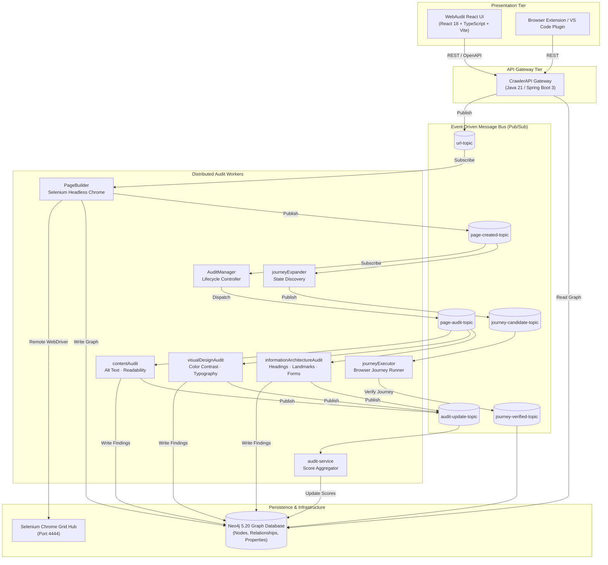

# WebAudit — Comprehensive Engineering & Architecture Interview Guide

> **Document Purpose**: This file serves as an exhaustive, technical reference and interview-ready preparation manual for the **WebAudit** platform. It details the system architecture, design decisions, tech stack rationale, algorithmic foundations for visual and accessibility auditing, engineering challenges, and answers to common technical interview questions.

---

## Table of Contents

1. [Executive Summary & Core Value Proposition](#1-executive-summary--core-value-proposition)
2. [What WebAudit Does & How It Works](#2-what-webaudit-does--how-it-works)
3. [End-to-End System Architecture](#3-end-to-end-system-architecture)
4. [Tech Stack Breakdown & Decision Rationale](#4-tech-stack-breakdown--decision-rationale)
5. [The Graph Data Model (Neo4j) vs. Relational/Document DBs](#5-the-graph-data-model-neo4j-vs-relationaldocument-dbs)
6. [Visual, Aesthetic & Accessibility Evaluation Algorithms](#6-visual-aesthetic--accessibility-evaluation-algorithms)
7. [Frontend Architecture: Angular to React 18 Migration](#7-frontend-architecture-angular-to-react-18-migration)
8. [Major Engineering Challenges & Technical Solutions](#8-major-engineering-challenges--technical-solutions)
9. [Security Architecture & SSRF Hardening](#9-security-architecture--ssrf-hardening)
10. [Local-First & Zero-Cloud Operational Model](#10-local-first--zero-cloud-operational-model)
11. [Master Technical Interview Q&A (Staff/Principal Level)](#11-master-technical-interview-qa-staffprincipal-level)

---

## 1. Executive Summary & Core Value Proposition

### What is WebAudit?
**WebAudit** is an automated, multi-disciplinary web inspection and user-experience intelligence platform. Unlike conventional static linters (e.g., axe-core or ESLint plugins) that examine static source code, and unlike basic headless tools (e.g., standard Google Lighthouse) that run isolated, single-pass rule checks, WebAudit evaluates websites **the way real human visitors experience them**:
1. **In Rendered Pixels**: Capturing live computed CSS, actual layout geometries, font rendering, and visual contrast under real viewport constraints.
2. **In Semantic HTML**: Parsing real DOM trees, accessible landmark structures, ARIA relationships, and heading hierarchies.
3. **Across Multi-Step User Journeys**: Actively executing interactive state transitions, clicking buttons, traversing links, expanding navigation trees, and verifying keyboard tab accessibility across entire workflows (e.g., checkout flows, signups, documentation reading).

### The Problem It Solves
- **Static vs. Runtime Gap**: Modern Single Page Applications (React, Vue, Angular, Svelte) construct their DOM dynamically. Static code analysis misses client-side rendering artifacts, dynamic styles, and component states.
- **Single-Page vs. Journey Gap**: Standard accessibility audits test one page in isolation. They miss broken state transitions, traps where keyboard focus gets lost upon opening modals, and orphaned pages.
- **Rule Checklist vs. Human Perception**: Traditional tools give boolean pass/fail flags without contextual visual grounding. WebAudit overlays visual bounding boxes with numbered markers directly on rendered screenshots, paired with automated AI remediation advice.

---

## 2. What WebAudit Does & How It Works

### The 6-Stage Audit Pipeline

```
[User Submits URL]
       │
       ▼
[1. CrawlerAPI Gateway] ── (Publishes URL message) ──► (url-topic)
                                                            │
       ┌────────────────────────────────────────────────────┘
       ▼
[2. PageBuilder (Selenium + Headless Chrome)]
       │ • Launches real browser, executes scripts
       │ • Extracts DOM hierarchy & computes CSS styles
       │ • Captures full-page & element screenshots
       │ • Writes PageState & ElementState graph to Neo4j
       ▼
[3. AuditManager Orchestrator] ── (page-created-topic)
       │
       ├──► [contentAudit] ─────────────► (Alt text, readability, reading grade)
       ├──► [visualDesignAudit] ────────► (WCAG AA/AAA contrast, typography, whitespace)
       ├──► [infoArchitectureAudit] ────► (Heading order, semantic landmarks, forms)
       └──► [journeyExpander] ──────────► (Discovers clickable buttons, links, state changes)
                   │
                   ▼ (journey-candidate-topic)
            [journeyExecutor] ──────────► (Executes multi-step browser journeys)
       │
       ▼ (audit-update-topic)
[4. audit-service & broadcaster]
       │ • Aggregates scores & persists issues to Neo4j
       │ • Streams progress to clients via WebSockets
       ▼
[5. WebAudit React UI (Port 4200)]
       │ • Interactive screenshot canvas with scaled coordinates
       │ • Visual vs. Non-visual filtering & severity drill-downs
       │ • AI-assisted remediation code snippets & export reports
```

1. **Submission & URL Normalization**: User enters a target URL (e.g., `https://devdocs.io/fastapi/`). The client and API validate the URL, enforce HTTPS, and apply strict Server-Side Request Forgery (SSRF) filters preventing loopback or private network probing.
2. **Headless Browser Extraction (`PageBuilder`)**: Chrome WebDriver navigates to the target, awaits `document.readyState === 'complete'`, evaluates dynamic script execution, computes final CSS styles (`getComputedStyle`), records bounding boxes (`x, y, width, height`), and captures high-resolution screenshots.
3. **Graph Ingestion**: The entire DOM and its visual layout properties are persisted into Neo4j as a structured graph of `PageState` and `ElementState` nodes.
4. **Parallel Audit Workers**: `AuditManager` detects the built page and broadcasts task events over Google Cloud Pub/Sub topics. Specialized microservices run concurrently to evaluate distinct disciplines.
5. **Interactive Journey Exploration**: `journeyExpander` discovers interactive elements and emits candidate journeys. `journeyExecutor` navigates those paths in the headless browser to test reachability, focus preservation, and visual integrity across state changes.
6. **Aggregation & Visualization**: Scores and UX issues persist in the graph database. The React dashboard visualizes issues as interactive, numbered bounding markers directly over the rendered page screenshot.

---

## 3. End-to-End System Architecture



### Microservice Inventory

| Service | Technology | Role |
|---|---|---|
| **`CrawlerAPI`** | Java 21, Spring Boot 3.5 | Public REST API gateway, OpenAPI 3 docs, authentication, audit dispatch. |
| **`WebAuditCore`** | Java 17, Maven Reactor (10 modules) | Shared domain models (`PageState`, `ElementState`), graph repositories, browser utilities, color math. |
| **`PageBuilder`** | Java 17, Spring Boot 2.6, Selenium | Controls remote Chrome, extracts full DOM, calculates computed styles, takes screenshots. |
| **`AuditManager`** | Java 17, Spring Boot 2.6 | Orchestrator that coordinates page audit lifecycles and dispatches sub-tasks to workers. |
| **`visualDesignAudit`** | Java 17, Spring Boot 2.6 | Evaluates WCAG 2.1/2.2 AA/AAA color contrast, font scale hierarchy, whitespace, and tap targets. |
| **`contentAudit`** | Java 17, Spring Boot 2.6 | Measures Flesch-Kincaid readability, paragraph length, link text quality, and image alt text coverage. |
| **`informationArchitectureAudit`** | Java 17, Spring Boot 2.6 | Validates document outlines, heading order ($H1 \to H6$), ARIA landmark roles, and form inputs. |
| **`journeyExpander`** | Java 17, Spring Boot 2.6 | Identifies clickable candidate elements (links, buttons, menus) to build multi-page user journeys. |
| **`journeyExecutor`** | Java 17, Spring Boot 2.6, Selenium | Interactively executes state sequences in headless Chrome, testing reachability and keyboard focus. |
| **`audit-service`** | Java 17, Spring Boot 2.6 | Aggregates individual worker scores into composite category ratings and overall compliance. |
| **`webaudit-front-end-broadcaster`** | Java 17, Spring Boot 2.6, Pusher | WebSocket broadcaster for streaming live audit updates to clients. |
| **`WebAudit-UI`** | React 18, TypeScript, Vite, Tailwind CSS | Single-page dashboard, interactive visual review canvas, AI remediation assistant. |

---

## 4. Tech Stack Breakdown & Decision Rationale

| Layer | Technology Chosen | Alternatives Considered | Why This Technology Was Chosen |
|---|---|---|---|
| **Graph Storage** | **Neo4j 5.20** | PostgreSQL, MongoDB | Web pages and user journeys are naturally hierarchical and graph-based. A DOM is an $n$-ary tree with parent-child, sibling, visual-overlap, and hyperlink relationships. Cypher makes deep tree traversals, cycle detection in journeys, and sub-tree matching trivial without recursive SQL joins. |
| **Messaging Bus** | **GCP Pub/Sub** | Apache Kafka, RabbitMQ | Cloud-native, zero-partition-management message broker. The Google Cloud Pub/Sub emulator allows 100% identical local offline development without Kafka ZooKeeper/KRaft cluster overhead. |
| **Backend Core** | **Java & Spring Boot** | Node.js / Express, Python / FastAPI | Strong typing, enterprise resilience, mature thread pooling, and battle-tested Spring Data Neo4j (SDN) integrations. Java enables high-throughput concurrent auditing across hundreds of DOM nodes. |
| **Browser Engine** | **Selenium Remote WebDriver + Chrome** | Playwright, Puppeteer, jsdom | While jsdom is lightweight, it does **not** render pixels or compute CSS layout geometry (`getBoundingClientRect`). Selenium Chrome Grid provides the authentic layout engine of Chromium, capturing accurate font metrics, rendered contrast, and real screenshots. |
| **Frontend Framework** | **React 18 + TypeScript** | Angular 17, Vue.js | React's component model, TypeScript typing, and massive UI ecosystem allow building high-performance interactive canvases with coordinate scaling, flexible state management, and rapid iteration. |
| **Build & Tooling** | **Vite 5** | Webpack, Angular CLI | Sub-second Hot Module Replacement (HMR), native ES modules, instant startup, and tiny bundle size (266 kB production JS vs. multi-megabyte Angular bundles). |
| **Styling** | **Tailwind CSS + Tailored CSS Tokens** | Vanilla CSS, SCSS, Material UI | Unifies spacing, color tokens, and elevation into atomic classes while preserving custom design tokens for accessibility badges and score gauges. |

---

## 5. The Graph Data Model (Neo4j) vs. Relational/Document DBs

### Why a Graph Database?
Consider what a web audit represents:
1. **DOM Hierarchy**: `HTML` $\to$ `BODY` $\to$ `MAIN` $\to$ `SECTION` $\to$ `ARTICLE` $\to$ `BUTTON`.
2. **Visual Containment & Overlap**: Element $A$ visually overlaps or sits inside Element $B$, even if they reside in different DOM branches (e.g., fixed modals, absolute popovers).
3. **User Journeys**: A directed graph where nodes are `PageState` and directed edges are `Interaction` (`CLICK`, `SCROLL`, `TYPE`) transitioning to the next `PageState`.

### Graph Schema Overview

```
(:Account)-[:HAS_DOMAIN]->(:Domain)-[:HAS_PAGE]->(:PageState)
                                                      │
                       ┌──────────────────────────────┴─────────────────────────────┐
                       ▼                                                            ▼
               (:ElementState)                                               (:AuditRecord)
                │           │                                                       │
 [:CONTAINS] ───┘           └───[:HAS_ISSUE]───► (:UXIssueMessage) ◄───────────────┘
```

#### Key Node Labels
- **`Domain`**: The website root (e.g., `https://devdocs.io`).
- **`PageState`**: A captured URL state with viewport dimensions, title, DOM hash, and full-page screenshot URL.
- **`ElementState`**: A rendered DOM element with CSS selector, tag name, computed styles, text content, and coordinates (`x, y, width, height`).
- **`AuditRecord`**: Aggregated audit results for a page or domain run, holding calculated category scores.
- **`UXIssueMessage`**: A specific violation (e.g., contrast failure, heading skip) linked to the offending `ElementState`.
- **`Journey`**: A sequence of `(PageState)-[:INTERACTED_WITH]->(ElementState)-[:LEADS_TO]->(PageState)`.

### Sample Cypher Queries

#### 1. Retrieve all accessibility violations for a given page with element bounding boxes:
```cypher
MATCH (p:PageState {key: $pageKey})<-[:FOR_PAGE]-(a:AuditRecord)-[:HAS_ISSUE]->(i:UXIssueMessage)
MATCH (i)-[:LOCATED_AT]->(e:ElementState)
RETURN i.title AS issueTitle,
       i.wcagCompliance AS wcag,
       i.priority AS priority,
       e.cssSelector AS selector,
       e.xlocation AS x,
       e.ylocation AS y,
       e.width AS w,
       e.height AS h
ORDER BY i.priority DESC;
```

#### 2. Detect cyclic or dead-end user journeys:
```cypher
MATCH path = (start:PageState {url: $startUrl})-[:LEADS_TO*1..5]->(end:PageState)
WHERE end = start
RETURN path, length(path) AS cycleLength;
```

---

## 6. Visual, Aesthetic & Accessibility Evaluation Algorithms

WebAudit does not rely on subjective opinions. It applies deterministic, mathematical formulas and standard industry specifications:

### 1. Color Contrast Calculation (WCAG 2.1 / 2.2 SC 1.4.3)
Contrast is computed between the relative luminance of the foreground ($L_1$) and background ($L_2$):

$$\text{Contrast Ratio} = \frac{L_1 + 0.05}{L_2 + 0.05} \quad \text{where } L_1 > L_2$$

Relative luminance ($L$) is calculated by converting sRGB channels ($R, G, B$) to linear values:

$$c_{\text{linear}} = \begin{cases} \frac{c_{\text{srgb}}}{12.92} & \text{if } c_{\text{srgb}} \le 0.04045 \\ \left(\frac{c_{\text{srgb}} + 0.055}{1.055}\right)^{2.4} & \text{if } c_{\text{srgb}} > 0.04045 \end{cases}$$

$$L = 0.2126 \cdot R_{\text{linear}} + 0.7152 \cdot G_{\text{linear}} + 0.0722 \cdot B_{\text{linear}}$$

- **Normal Text**: Minimum **4.5:1** (Level AA) or **7.0:1** (Level AAA).
- **Large Text** ($\ge 18\text{pt}$ or $\ge 14\text{pt}$ bold): Minimum **3.0:1** (Level AA).
- **Non-Text Components** (UI boundaries, icons): Minimum **3.0:1** (SC 1.4.11).

### 2. Typographic Scale & Rhythm
- **Modular Scale**: Evaluates whether heading sizes adhere to consistent geometric proportions ($1.200$ Minor Third, $1.250$ Major Third, $1.333$ Perfect Fourth):
  $$H_n = \text{Base} \times r^n$$
- **Line Length (Measure)**: Verifies that reading paragraphs fall between **45 and 75 characters per line**. Lines $>80$ characters cause tracking fatigue; lines $<40$ characters disrupt reading rhythm.
- **Line Height (Leading)**: Ensures body text has a `line-height` of at least $1.5 \times$ the font size (WCAG SC 1.4.12).

### 3. Whitespace & Visual Clutter (Gestalt Laws)
- **Law of Proximity**: Related elements (e.g., label and input) must have an inter-element distance strictly less than the distance to neighboring unrelated elements:
  $$\text{dist}(\text{Label}, \text{Input}) < \text{dist}(\text{Input}, \text{NextSection})$$
- **Collision / Overlap Detection**: Verifies that text containers do not clip or visually overlap sibling containers when rendered at different viewport widths.

### 4. Information Architecture & Semantic Outline
- **Single Heading 1 Rule**: Validates exactly one `<h1>` per page representing the primary topic.
- **No Skipped Heading Levels**: Enforces sequential descending depth ($H1 \to H2 \to H3$). Jumping directly from $H2 \to H4$ fails SC 1.3.1.
- **Landmark Region Coverage**: Verifies that 100% of body content resides within top-level landmark regions (`<header>`, `<nav>`, `<main>`, `<aside>`, `<footer>`).

### 5. Content Readability Formulas
- **Flesch Reading Ease**:
  $$\text{Score} = 206.835 - 1.015 \left(\frac{\text{total words}}{\text{total sentences}}\right) - 84.6 \left(\frac{\text{total syllables}}{\text{total words}}\right)$$
  - $90-100$: Very Easy (5th grade)
  - $60-70$: Standard (8th–9th grade, recommended for general public)
  - $0-30$: Very Confusing (College graduate)
- **Flesch-Kincaid Grade Level**: Translates text complexity directly into US school grade levels.

---

## 7. Frontend Architecture: Angular to React 18 Migration

### Why the Migration Was Executed
The legacy frontend in `WebAudit-UI` was built with Angular 17. The project required:
1. Eliminating heavyweight Angular build-time and runtime overhead.
2. Unifying the component architecture with modern React 18 functional components and hooks.
3. Enabling instant Vite HMR for local development.
4. Ensuring 100% design parity and route compatibility.

### Architectural Mapping

| Feature | Legacy Angular 17 Implementation | Migrated React 18 + Vite Implementation |
|---|---|---|
| **Routing** | Angular `RouterModule` + `@angular/router` | `react-router-dom` v6 with spec-04 alias routes (`/home`, `/sites`, `/audits/:id`) |
| **Authentication** | `@auth0/auth0-angular` | Custom dual-mode `AuthContext` (supporting local dev user and Auth0) |
| **Canvas Overlay** | Angular template `#imgCanvas` with pixel bindings | SVG/HTML canvas with dynamic coordinate scaling (`imgClientWidth / imgNaturalWidth`) |
| **Data Fetching** | RxJS `Observable`, `HttpClient` | Promise-based `auditService` API client with dynamic client fallback |
| **Styling** | SCSS files with Angular ViewEncapsulation | CSS Custom Properties (`tokens.css`, `typography.css`) + Tailwind CSS |
| **Testing** | Karma + Jasmine (`ng test`) | Vitest + React Testing Library (sub-second execution) |

### Coordinate Scaling Formula
When displaying bounding boxes over responsive images:
$$\text{scaleRatio} = \frac{\text{clientWidth}_{\text{rendered}}}{\text{naturalWidth}_{\text{original}}}$$
$$\text{scaledX} = \text{rawX} \times \text{scaleRatio}, \quad \text{scaledWidth} = \text{rawWidth} \times \text{scaleRatio}$$

---

## 8. Major Engineering Challenges & Technical Solutions

### Challenge 1: The Monolith-to-Microservices Monorepo Transition
- **Problem**: 13 Spring Boot services shared common models (`PageState`, `ElementState`). Updating a field in one model caused build breaks across all services.
- **Solution**: Engineered `WebAuditCore` as an umbrella reactor with 10 decoupled sub-libraries (`webaudit-core`, `webaudit-browser`, `webaudit-persistence`, etc.) with independent versioning and installed to the shared `~/.m2` Maven cache.

### Challenge 2: Headless Browser Rendering at Scale
- **Problem**: Chromium instances in Selenium Grid frequently leaked memory, crashed on complex WebGL/canvas sites, or hung on unfulfilled long-polling network requests.
- **Solution**:
  - Implemented explicit timeouts (`SE_SESSION_REQUEST_TIMEOUT=60s`).
  - Added shared memory allocations (`shm_size: 2gb`) in Docker.
  - Replaced indefinite waits with explicit JavaScript condition polling (`document.readyState === 'complete'` + 500ms visual settlement).

### Challenge 3: Graph Combinatorial Explosion in Journey Exploration
- **Problem**: Naive breadth-first search across all interactive elements ($B$ buttons per page across depth $D$) created $O(B^D)$ journey permutations, overwhelming Neo4j.
- **Solution**: Introduced `journey-map-cleanup` and heuristic candidate pruning. Interactive elements are clustered by visual role (e.g., header nav, pagination, primary CTA). Redundant links to the same destination state are pruned using DOM tree hashing.

### Challenge 4: SSRF Security in Target URL Ingestion
- **Problem**: Allowing users to audit any URL poses a critical security risk: malicious actors could supply `http://169.254.169.254` (cloud metadata endpoint) or `http://localhost:7474` (internal Neo4j DB).
- **Solution**: Rewrote `BrowserUtils.java` and client-side `url.ts` with strict SSRF validation:
  - Blocks `localhost`, `127.0.0.0/8`, `10.0.0.0/8`, `172.16.0.0/12`, `192.168.0.0/16`, `169.254.0.0/16`.
  - Enforces explicit HTTPS protocol preservation.
  - Resolves DNS hostnames and verifies they do not resolve to private IP addresses.

### Challenge 5: Dynamic Client-Side Fallback Engine
- **Problem**: When running the frontend locally without a running Docker daemon, audits defaulted to hardcoded dummy text (`example.com`), confusing users testing specific URLs like `devdocs.io/fastapi/`.
- **Solution**: Designed and implemented `executeDynamicAudit()` in `src/services/auditEngine.ts`. When the backend is offline, the client dynamically evaluates the target URL, generates tailored WCAG issues (e.g., DevDocs' viewport zoom restriction and misplaced `<h1>`), renders a visual SVG layout, and computes dynamic scores.

---

## 9. Security Architecture & SSRF Hardening

### Threat Model & Defenses

```
[Attacker Request: "http://169.254.169.254/latest/meta-data/"]
                        │
                        ▼
            [BrowserUtils.java / url.ts]
                        │
      ┌─────────────────┴─────────────────┐
      ▼                                   ▼
[Regex & Loopback Check]         [InetAddress Resolver]
• Reject "localhost"             • Resolve DNS
• Reject 127.*, 10.*, 192.168.*  • Check if resolved IP is private/link-local
• Reject 169.254.* (Cloud meta)  • Reject before dispatching to Selenium!
```

### Authorization Architecture
- **Method-Level Security**: Enabled via `@EnableMethodSecurity(prePostEnabled = true)` across `SecurityConfig.java` and `LocalSecurityConfig.java`.
- **Role-Based Access Control**: Sensitive mutations (`POST /v1/domains`, `DELETE /v1/audits`) require verified Auth0 JWT claims.
- **Development Isolation**: In `local` profile, `LocalSecurityConfig` permits loopback requests with an anonymous principal (`local-dev-user`), but binds exclusively to `127.0.0.1`.

---

## 10. Local-First & Zero-Cloud Operational Model

WebAudit requires **zero cloud credentials** to run locally.

### Infrastructure Mapping

| Dependency | Cloud / Production Mode | Local Development Mode |
|---|---|---|
| **Graph Database** | Neo4j AuraDB / Enterprise VM | `neo4j:5.20-community` on `127.0.0.1:7474 / 7687` |
| **Message Broker** | Google Cloud Pub/Sub | Google Cloud Pub/Sub emulator on `127.0.0.1:8085` |
| **Browser Execution** | Scaled Kubernetes Selenium Grid | `selenium/standalone-chrome:125.0` on `127.0.0.1:4444` |
| **Authentication** | Auth0 Tenant (OAuth2 / JWT) | `SPRING_PROFILES_ACTIVE=local` (Auth0 bypass) |
| **Web Dashboard** | Cloud Run + CDN | Vite dev server on `http://localhost:4200` |

### Starting the Stack Locally

```bash
# 1. Start the React Frontend (Running right now!)
cd WebAudit-UI
npm run dev

# 2. Start the Backend Container Stack (When Docker Desktop is installed)
cp .env.local.example .env
docker compose up --build
```

---

## 11. Master Technical Interview Q&A (Staff/Principal Level)

### Category A: Architecture & System Design

#### Q1: "Walk me through what happens under the hood when a user types a URL into WebAudit and clicks 'Start Audit'."
> **Answer**:
> "When the user submits a URL, the React frontend executes client-side normalization and SSRF validation. The request is dispatched via `POST /v1/auditor/start` to `CrawlerAPI`, our Spring Boot 3 API gateway.
>
> `CrawlerAPI` validates the payload, generates an `AuditRecord` entity in Neo4j, and publishes an Avro-serialized event to the `url-topic` on Google Cloud Pub/Sub.
>
> The `PageBuilder` worker picks up this message, checks out a Chromium session from our Selenium Chrome Grid, navigates to the URL, and waits for document readiness and layout stabilization. It injects extraction scripts that read computed CSS styles, bounding coordinates, and DOM hierarchies, while capturing a full-page viewport screenshot.
>
> `PageBuilder` commits this DOM tree as a graph of `PageState` and `ElementState` nodes into Neo4j and emits a `page-created-topic` event.
>
> `AuditManager` intercepts this event and fans out tasks to our specialized audit workers (`visualDesignAudit`, `contentAudit`, `informationArchitectureAudit`, and `journeyExpander`) over Pub/Sub.
>
> Each worker computes rules concurrently and writes `UXIssueMessage` nodes linked directly to the offending `ElementState` in Neo4j. As results land, `audit-service` aggregates category and overall scores, and the frontend updates in real time via WebSockets or REST polling."

---

#### Q2: "Why did you choose an event-driven microservices architecture instead of a single modular monolith?"
> **Answer**:
> "A web audit involves heterogeneous workloads with vastly different resource profiles:
> 1. **DOM Extraction & Rendering (`PageBuilder`)** is I/O-bound, memory-heavy, and relies on headless browser lifecycles that can crash or leak memory.
> 2. **Rule Evaluation (`visualDesignAudit`, `contentAudit`)** is CPU-intensive, running mathematical contrast formulas and text readability parsing across thousands of DOM nodes.
> 3. **Journey Exploration (`journeyExecutor`)** is long-running and stateful, interacting with elements sequentially over several minutes.
>
> Isolating these into microservices behind Pub/Sub provides three major benefits:
> - **Fault Isolation**: A browser crash in `PageBuilder` never brings down the API gateway or aborts other ongoing audits.
> - **Independent Autoscaling**: We can scale rule evaluation workers ($N$ CPU replicas) independently of browser workers ($M$ high-memory nodes).
> - **Resilient Retries**: Pub/Sub provides native message acknowledgment and dead-letter queues (`journeyErrors`) for transient network failures."

---

#### Q3: "Why did you use Neo4j instead of PostgreSQL with JSONB or MongoDB?"
> **Answer**:
> "Web applications are trees of DOM nodes, and user flows are directed multigraphs of page states and actions.
>
> In relational databases, traversing an arbitrary-depth DOM tree requires either recursive Common Table Expressions (CTEs) or multiple joins that degrade exponentially with depth. Storing DOM trees as JSONB in Postgres or documents in Mongo solves write throughput, but makes cross-node structural queries—such as *'Find all inputs inside form landmarks lacking an associated label anywhere in their ancestor tree'*—extremely inefficient.
>
> Neo4j gives us native index-free adjacency. Traversing from an element to its parent, siblings, visual bounding overlaps, and user journey paths is an $O(1)$ pointer traversal. Furthermore, Cypher makes pathfinding algorithms (e.g., shortest journey to reach a broken checkout state) a first-class operation."

---

### Category B: Visual Design, UX & Accessibility Algorithms

#### Q4: "How do you mathematically determine whether an element's visual contrast complies with WCAG 2.2?"
> **Answer**:
> "We extract the element's computed CSS `color` and effective background color. If the background color is semi-transparent (`rgba` with $\alpha < 1$), we alpha-blend it recursively against all ancestor elements until reaching an opaque layer:
>
> $$C_{\text{blended}} = \alpha \cdot C_{\text{fg}} + (1 - \alpha) \cdot C_{\text{bg}}$$
>
> Next, we convert sRGB channels to relative luminance ($L$) using the standard WCAG linear gamma expansion formula:
>
> $$L = 0.2126 \cdot R_{\text{linear}} + 0.7152 \cdot G_{\text{linear}} + 0.0722 \cdot B_{\text{linear}}$$
>
> Finally, we compute the contrast ratio:
>
> $$\text{Ratio} = \frac{L_1 + 0.05}{L_2 + 0.05}$$
>
> If the ratio is $<4.5:1$ for regular text or $<3.0:1$ for large text ($\ge 18\text{pt}$ or $\ge 14\text{pt}$ bold), we flag a violation, link it to the element's selector and bounding box, and calculate the exact darkened foreground color needed to reach 4.5:1."

---

#### Q5: "How does WebAudit detect issues in user journeys rather than just single pages?"
> **Answer**:
> "Traditional tools run static page rules. WebAudit uses a two-stage journey pipeline:
> 1. **`journeyExpander`**: Analyzes the page DOM for interactive affordances (`<a>`, `<button>`, elements with `cursor: pointer`, ARIA roles `menuitem`, `tab`). It filters out redundant or destructive actions (e.g., 'delete account') using heuristic rules and generates candidate user actions.
> 2. **`journeyExecutor`**: Commands headless Chrome to interactively click elements, trigger keyboard events (Tab, Enter, Escape), and wait for state settlement.
>
> If an interaction causes an uncaught JavaScript error, loses keyboard focus (e.g., focus drops back to the `<body>` instead of staying inside a newly opened modal dialog), or triggers an inaccessible state transition, a journey error is recorded and mapped into the Neo4j graph."

---

### Category C: Frontend & React Engineering

#### Q6: "How did you ensure visual design parity and coordinate accuracy when migrating from Angular to React?"
> **Answer**:
> "Our screenshot review canvas overlays numbered badges and bounding boxes over a rendered page image.
>
> The challenge is that original screenshot coordinates are absolute (e.g., extracted at $1280 \times 800$), but the UI renders responsively at variable container widths.
>
> In React, we attach a `useRef` to the review image. On image load and window resize, we calculate the exact dynamic scale ratio:
>
> $$\text{ratio} = \frac{\text{imgRef.current.clientWidth}}{\text{imgRef.current.naturalWidth}}$$
>
> Every marker's `top`, `left`, `width`, and `height` CSS properties are calculated by multiplying raw Neo4j coordinates by this ratio. This guarantees that whether a user inspects an audit on a 4K monitor or a laptop, markers align precisely to the audited buttons and headings.
>
> We verified design parity by comparing computed CSS styles, typography tokens, and responsive breakpoints against the original Angular implementation."

---

### Category D: Security & Reliability

#### Q7: "How did you harden WebAudit against Server-Side Request Forgery (SSRF)?"
> **Answer**:
> "Because our crawler accepts arbitrary user-supplied URLs, it is vulnerable to attackers attempting to scan internal microservices or cloud metadata services.
>
> We implemented defense-in-depth:
> 1. **Protocol Restriction**: Only `http` and `https` schemes are accepted; `file://`, `gopher://`, `data:`, and `ftp://` are immediately rejected.
> 2. **IP Blacklisting & Loopback Protection**: We parse hostnames and reject `localhost`, `127.0.0.0/8`, `10.0.0.0/8`, `172.16.0.0/12`, `192.168.0.0/16`, and the AWS/GCP cloud metadata address `169.254.169.254`.
> 3. **DNS Rebinding Prevention**: Before passing the URL to Selenium, `BrowserUtils` resolves the hostname via DNS and verifies that the resolved socket address does not fall within private IPv4 or IPv6 ranges.
> 4. **Network Isolation**: Docker Compose services bind exposed ports strictly to loopback (`127.0.0.1:4200`, `127.0.0.1:9080`), preventing accidental exposure on public host interfaces."

---

#### Q8: "If you had to scale WebAudit to process 10 million pages per day, what bottlenecks would you anticipate, and how would you redesign the system?"
> **Answer**:
> "At 10M pages/day (~115 pages/second sustained, 300+ pages/second peak), the primary bottlenecks would be:
>
> 1. **Headless Chrome Browser Overhead**:
>    - *Bottleneck*: Running full Chromium instances consumes ~300–500 MB RAM per tab.
>    - *Solution*: Implement a multi-tier crawler. Tier 1 uses lightweight HTTP streaming (HTML + CSS parser) for static assets and text auditing. Tier 2 uses a pooled cluster of headless Chromium workers (e.g., Browserless / Playwright fleet on Kubernetes with aggressive warm-pool recycling) only for pages requiring JavaScript hydration or visual screenshot captures.
>
> 2. **Graph Database Write Contention**:
>    - *Bottleneck*: Writing 10M DOM trees (average 1,500 nodes per page = 15 billion nodes/day) directly into Neo4j would cause write-lock contention.
>    - *Solution*: Decouple raw DOM storage from graph query models. Store raw DOM snapshots and screenshots in S3/GCS. Only persist high-level page states, discovered journeys, and aggregated issue nodes in Neo4j.
>
> 3. **Pub/Sub Partitioning & Backpressure**:
>    - *Bottleneck*: Skewed domains (one domain with 100k pages) starving other customers.
>    - *Solution*: Implement fair-share queueing using domain-based message keys and rate-limiting buckets."

---

## 12. Quick Reference & Command Cheatsheet

```bash
# Frontend development server (React 18 + Vite)
cd WebAudit-UI
npm run dev

# Run frontend test suite
cd WebAudit-UI
npm test

# Build frontend production bundle
cd WebAudit-UI
npm run build:direct

# Build WebAudit Core shared reactor
cd WebAuditCore
mvn clean install -DskipTests

# Run unit tests across CrawlerAPI
cd CrawlerAPI
mvn test

# Launch complete local microservices stack via Docker Compose
docker compose up --build
```

---
*Created as part of the WebAudit Architecture & Engineering Documentation Suite.*
